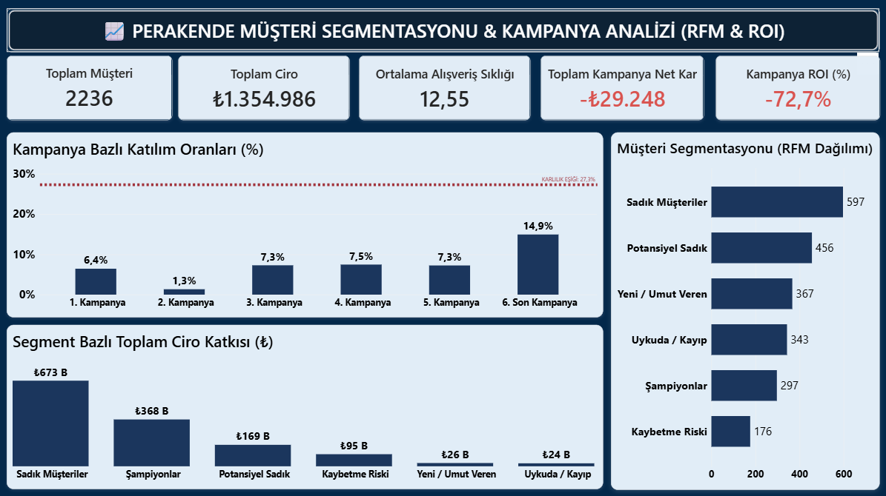
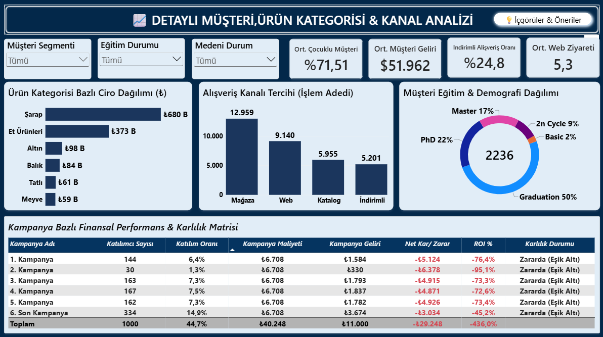
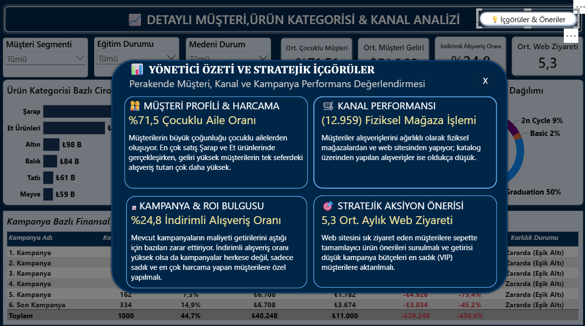

# 📊 Perakende Müşteri Analitiği, RFM Segmentasyonu & Kampanya ROI Dashboard

Bu proje, perakende sektöründeki müşteri demografisini, ürün kategorisi harcamalarını, alışveriş kanalı tercihlerini ve pazarlama kampanyalarının yatırım getirisini (ROI) uçtan uca analiz etmek amacıyla geliştirilmiş bir **SQL Server & Power BI** iş zekası çalışmasıdır.

Projede karmaşık DAX formülleri yerine **SQL-First (Veritabanı Odaklı)** bir yaklaşım benimsenmiş; tüm veri kontrolleri, RFM segmentasyonu, kampanya ROI hesaplamaları ve temel KPI metrikleri **Microsoft SQL Server (`RetailAnalyticsDB`)** üzerinde oluşturulan görünümler (`VIEW`) aracılığıyla hazırlanarak **Power BI** arayüzüne doğrudan görselleştirmeye hazır şekilde aktarılmıştır.

---

## 📁 Veri Seti ve Dönem Bilgisi

* **Veri Seti Kaynağı:** [Kaggle — Customer Personality Analysis](https://www.kaggle.com/datasets/imakash3011/customer-personality-analysis) (`marketing_campaign_raw`)
* **Veri Seti Dönemi:** 2012 – 2014 yılları arasındaki müşteri kayıtlarını ve kampanya etkileşimlerini kapsamaktadır.
* **Kapsam:** 2.236 geçerli müşteri kaydı üzerinden demografik bilgiler (eğitim, medeni durum, hane içi çocuk durumu, yıllık gelir), ürün bazlı harcamalar (Şarap, Et, Balık, Meyve, Tatlı, Altın), satış kanalı kullanımları (Fiziksel Mağaza, Web, Katalog, İndirimli Alışveriş) ve 6 farklı pazarlama kampanyasına verilen yanıtlar.

---

## ⚙️ Veri Hazırlama ve Analiz Süreci

1. **Veri Ön Kontrolü ve Temizlik Doğrulaması (`01_Data_Cleaning_Execution` & `02_Before_After_Comparison`):**
   * Kaggle üzerinden alınan `marketing_campaign_raw` veri seti SQL Server ortamına aktarıldıktan sonra eksik (`NULL`) gelir kayıtları, veri tipleri ve tutarlılık kontrolleri yapıldı; analiz **2.236 geçerli müşteri** üzerinden kurgulandı. `marketing_campaign_clean`
   * Yıllık gelir değerleri veri setinin dönemsel gerçekliğini korumak adına orijinal **USD ($)** birimiyle bırakıldı.

2. **SQL Server Veri Mimarisi (`RetailAnalyticsDB`):**
   * **RFM Analizi (`vw_Customer_RFM`):** Müşterilerin son alışveriş yeniliği (*Recency*), alışveriş sıklığı (*Frequency*) ve toplam harcama tutarı (*Monetary*) puanlanarak müşteriler segmentlere ayrıldı.
   * **Ürün Kategorisi Analizi (`vw_Urun_Kategorileri`):** 6 ürün kategorisinin toplam ciro içindeki payları ve harcama dağılımları modellendi.
   * **Kanal Performansı (`vw_Kanal_Tercihleri`):** Fiziksel mağaza, web ve katalog kanallarının işlem sayıları ile aylık web ziyaret yoğunlukları hesaplandı.
   * **Kampanya ROI & Finansal Performans (`vw_Campaign_ROI`):** Kampanya katılımları, gelir, maliyet ve net kâr/zarar (ROI %) metrikleri oluşturuldu.
   * **Genel KPI Özeti (`vw_Genel_KPI`):** Çocuklu aile oranı, ortalama yıllık gelir, indirimli alışveriş oranı ve aylık ortalama web ziyareti metrikleri `ISNULL`/`NULLIF` kontrolleriyle güvenli hale getirildi.

3. **Power BI Görselleştirme ve UX Tasarımı:**
   * RFM segmenti, eğitim durumu ve medeni durum dilimleyicileri ile dinamik filtreleme sağlandı.
   * **Yer İşaretleri (Bookmarks)** ve **Seçim Paneli (Selection Pane)** kullanılarak sağ üstteki *"💡 İçgörüler & Öneriler"* butonuyla açılıp kapanabilen, arka plan karartmalı ve 2x2 kart düzenine sahip etkileşimli yönetici özeti ekranı tasarlandı.

---

## 🔍 Özet Bulgular

* **Müşteri Profili:** Müşteri tabanının **%71,51'i** çocuklu ailelerden oluşmaktadır ve ortalama yıllık hane geliri **$51.962** seviyesindedir.
* **Kanal Dağılımı:** İşlemlerin büyük bölümü **Fiziksel Mağaza (12.959 işlem)** ve **Web** kanallarında yoğunlaşmaktadır.
* **Kampanya & İndirim:** İndirimli alışveriş oranı **%24,8** seviyesindeyken, mevcut pazarlama kampanyalarının bir kısmı yüksek maliyet nedeniyle negatif ROI üretmektedir.

👉 **Tüm detaylı segment kırılımları, kampanya analizleri, stratejik aksiyon önerileri ve bu veri modeliyle cevaplanabilen iş soruları için [Detaylı Analiz Raporu](ANALIZ_RAPORU.md) sayfasını inceleyebilirsiniz.**

---

## 🛠️ Kullanılan Teknolojiler

* **Microsoft SQL Server** (Veri temizleme kontrolleri, analitik görünümler / `VIEW`)
* **Microsoft Power BI Desktop** (Veri görselleştirme, Bookmarks, Selection Pane, etkileşimli tasarım)

---

## 📸 Dashboard Ekran Görüntüleri

### 1. RFM Segmentasyonu & Kampanya ROI Analizi

### 2. Detaylı Müşteri, Ürün Kategorisi & Kanal Analizi

### 3. Etkileşimli Yönetici Özeti Pop-up Görünümü

